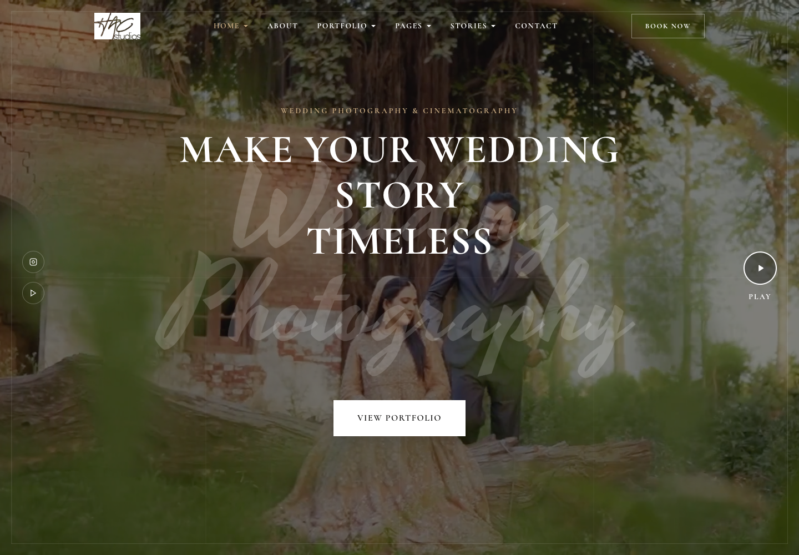

<div align="center">

# HAC Studios

### Wedding photography, film, and the code behind both site versions

[](src/build.py)
[](src/assets/js/main.js)
[](wordpress/esthetic-child)

[**Visit the live website ↗**](https://www.thehacstudios.com/) · [Run locally](#run-locally) · [Architecture](docs/ARCHITECTURE.md)

</div>



HAC Studios is a wedding photography and cinematography portfolio. This repository documents two stages of the project: a custom, 15-route static website built with Python, HTML, CSS, and JavaScript; and the custom child-theme code used in the later WordPress/Gutenverse implementation.

Visitors can browse full-screen wedding films, editorial image layouts, services, stories, and the inquiry page.

> **Demo scope:** the live link points to the existing WordPress website. The locally runnable static version is an earlier implementation and is not an exact export of the current production site. Its booking form is a clearly labelled interface demonstration; it does not send messages or store submissions.

## Experience

| Area | Implemented behavior |
|---|---|
| Homepage film | Muted background video, poster fallback, and film playback in a modal |
| Editorial portfolio | Image-led project cards, alternate portfolio layouts, and a featured wedding story |
| Navigation | Sticky header, desktop menus, mobile drawer, and submenu accordions |
| Motion | IntersectionObserver reveals, CSS animation, and reduced-motion styling |
| Business pages | About, services, team, pricing, FAQ, contact, privacy, and terms |
| Search/social metadata | Page titles, descriptions, canonical links, Open Graph/Twitter tags, sitemap, and robots file |
| Asset delivery | Content-hashed CSS and JavaScript, WebP photography, and local video assets |
| WordPress customization | Clean-route redirects, inline SVG social icons, and a featured-film modal |

## Run locally

**Requirements:** Python 3 and a modern browser. The static build uses only Python's standard library; no Node packages, database, account, or API key is required.

```bash
git clone https://github.com/awanafnan17/TheHACStudios.git
cd TheHACStudios
python3 src/build.py
python3 -m http.server 8000 --directory dist
```

Open **http://localhost:8000**. Serve the generated `dist/` folder at the site root because the static implementation uses root-relative links. Opening HTML files directly from disk is not the supported preview path.

## Project structure

```text
TheHACStudios/
├── src/
│   ├── build.py                  # Page templates, routes, SEO, and build pipeline
│   ├── data/media-selection.json # Content/media mapping
│   └── assets/                   # CSS, JavaScript, photography, and film assets
├── wordpress/esthetic-child/
│   ├── functions.php             # Custom WordPress hooks and film modal
│   └── style.css                 # Child-theme metadata and presentation
├── docs/
│   ├── ARCHITECTURE.md
│   └── DEPLOYMENT.md
└── dist/                         # Generated locally; excluded from Git
```

## Customize

1. Edit page content and the canonical domain in `src/build.py`.
2. Update photo selections and editorial captions in `src/data/media-selection.json`.
3. Adjust typography, layout, and motion in `src/assets/css/style.css`.
4. Change interactions in `src/assets/js/main.js`.
5. Rebuild and inspect the output at desktop and mobile widths.

The static site uses Cormorant, Cormorant Garamond, Heebo, and Yesteryear via Google Fonts, with local fallback fonts when the font service is unavailable.

## Production implementation

The later website runs on WordPress with the Esthetic theme and Gutenverse blocks. The `wordpress/esthetic-child` directory contains the custom child-theme source. WordPress core, the parent theme bundle, plugins, database content, production configuration, administrator credentials, and deployment sessions are intentionally not part of the source distribution.

See [architecture](docs/ARCHITECTURE.md) for how both implementations fit together and [deployment](docs/DEPLOYMENT.md) for static hosting and WordPress setup.

## Validation and limitations

This release builds all 15 HTML routes successfully and checks internal assets and route references against the generated output. The static form has no backend. Review the social placeholders and content before adapting the preview for another business. This source does not reproduce the production WordPress database or editor state.

## Attribution and content

The Esthetic child-theme metadata retains its upstream attribution and GPL notice. Brand identity, client photography, films, and third-party theme materials retain their respective rights; publishing this portfolio source does not grant a separate license to reuse those assets. No blanket license has been added over third-party or client materials.

Built and customized by [Afnan Mehmood Awan](https://github.com/awanafnan17).
