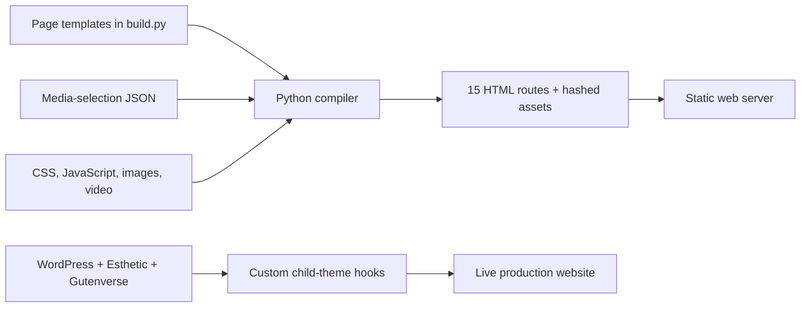

# Architecture

## Two implementation stages

The static version is a reproducible Python build. The newer live deployment uses WordPress, Esthetic, and Gutenverse. They share the same business and visual direction but do not share a runtime. The static build is not presented as a WordPress export.

## Static build

`src/build.py` reads the media catalog and stylesheet/script source. It computes SHA-256-based eight-character asset suffixes, replaces its generated `dist/` directory, copies the assets, renders each route, and emits a sitemap and robots file. This is a build-time application: Python does not run on the web server.

| Routes | Purpose |
|---|---|
| `/`, `/home-2/` | Two home/film compositions |
| `/about/`, `/services/`, `/our-team/` | Studio and service presentation |
| `/portfolio/`, `/portfolio-2/`, `/portfolio-story/` | Portfolio layouts and featured story |
| `/pricing/`, `/faq/`, `/contact/` | Inquiry preparation and contact interface |
| `/stories/`, `/story/` | Editorial stories |
| `/privacy-policy/`, `/terms/` | Business/legal content pages |

### Browser behavior

The frontend is vanilla JavaScript. A passive scroll handler changes header styling; click handlers manage mobile navigation, video playback, and the demo form. IntersectionObserver reveals elements once as they enter the viewport. CSS supplies the layout, responsive breakpoints, typography, keyframes, and reduced-motion rules. No AI model is used in the website runtime.

### Content model

`media-selection.json` maps visual roles such as hero, about, team, and contact to local media and alternative text. It also supplies portfolio item metadata. Media stored in this snapshot is limited to files referenced by the static implementation, rather than the entire working media archive.

## WordPress child theme

`functions.php` registers WordPress hooks to enqueue parent and child styles, redirect legacy routes, render SVG social icons, and append an accessible video modal with Escape-key support. Its video points to a WordPress uploads path that must be provisioned on the target installation.

`style.css` defines the child-theme identity and styles social buttons, gallery image fitting, and the featured-film overlay. The parent theme and Gutenverse plugin must be installed separately. Page content, block layouts, media IDs, and production settings live in WordPress and are not reconstructed from these two files.

## Data boundary

The static implementation has no database and no credential requirement. The WordPress implementation naturally requires a database and admin account, but none of that private state is distributed here. The source snapshot excludes private deployment tools, credentials, backups, logs, and WordPress configuration.
